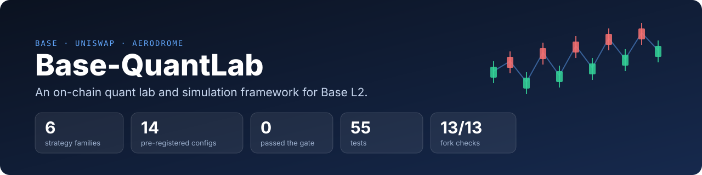
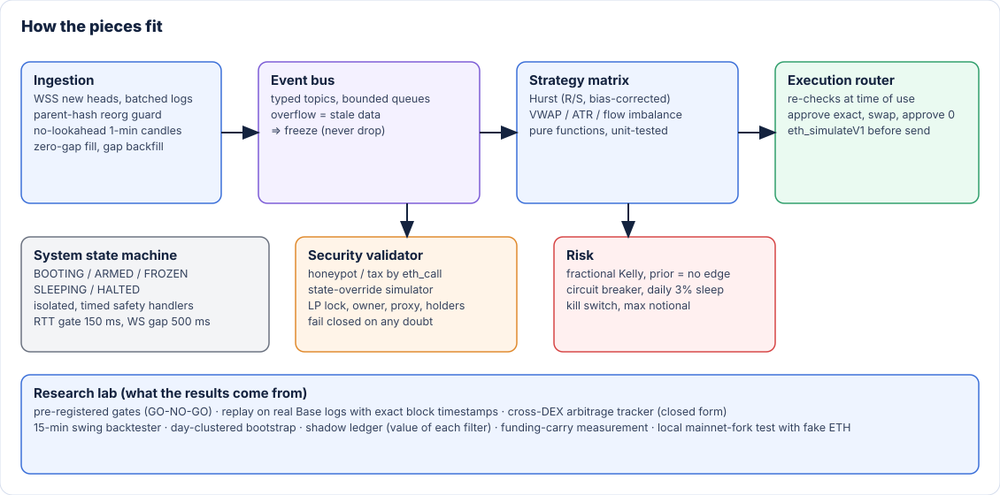
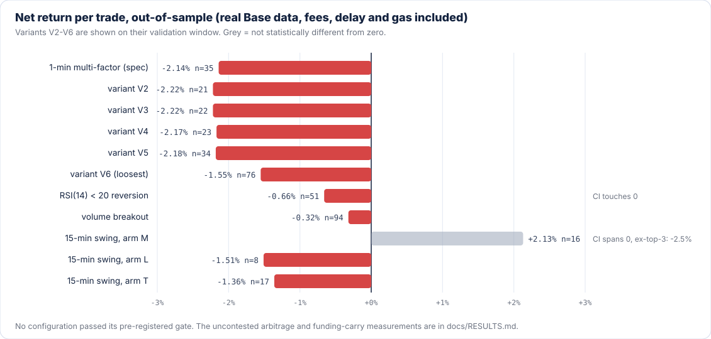

<p align="center">
  
</p>

<p align="center">
  <a href="https://github.com/ntinosgkiou-code/base-quantlab/actions/workflows/ci.yml"></a>
  
  
  
  
</p>

# Base-QuantLab

**An on-chain quant lab and simulation framework for Base L2: it tells you whether a strategy survives real fees, latency and adversarial conditions *before* capital goes in.**

## Abstract

Base-QuantLab is a modular Python framework for building, simulating and stress-testing on-chain trading strategies on Base
(Uniswap V2/V3, Aerodrome). It couples an execution stack (reorg-safe ingestion, a fail-closed token-safety validator, strategy and risk
layers, an execution router) with an evaluation harness that replays **real on-chain logs** under realistic frictions (LP fees, L2 gas and
data fees, execution delay) and judges every strategy against **pass/fail gates written before it runs**.

This repository documents the evaluation of **14 pre-registered configurations from six strategy families**: 1-minute multi-factor scalping,
RSI reversion, volume breakout, cross-DEX arbitrage (including a study under Base's new 0.2 s block regime), 15-minute swing trading and
delta-neutral funding carry. **None passed.** The negative results, and the methodology that produced them in hours instead of after a launch,
are the deliverable. It uses an institutional-style research process (pre-registration, out-of-sample windows, clustered bootstrap, multiple-testing
correction); it is research software and has not been audited.

## What it does and what it solves

| The usual failure | What this repo does about it |
|-------------------|------------------------------|
| Backtest ignores execution costs | Fills happen on the **next block's real pool reserves**, with the pool's LP fee, extra adverse slippage, gas **and the OP-stack L1 data fee** |
| Tuned until it passes | **Gates are written before any result is seen** ([docs/METHODOLOGY.md](docs/METHODOLOGY.md)); amendments are logged with the reason |
| Look-ahead bias | Candles are emitted only after a later-minute block exists; signals use closed candles; tests assert future data cannot change past values |
| One lucky window | Each new idea runs **once** on a window nobody has tuned on; bootstrap confidence intervals (**clustered by day** in the 15-minute study); the confidence level tightens as hypotheses accumulate (95% → 97.5% → 99.67%) |
| "Is this token a honeypot?" | Fail-closed validator: a state-override `eth_call` simulates buy → transfer → sell and measures tax; plus LP-lock, owner/timelock, proxy and exact holder-concentration checks |
| "What happens when the network misbehaves?" | A state machine freezes on latency spikes, WebSocket gaps, bus overflow, reorgs or unexpected slippage, and revokes allowances |

## Architecture

<p align="center"></p>

| Module | What it does | Code |
|--------|--------------|------|
| **1. Ingestion** | WSS new heads, one batched log query per second (free-RPC friendly), parent-hash **reorg guard**, lookahead-free 1-minute candles with zero-gap fill, automatic **gap backfill** after reconnects. (Base has no public mempool, so there is no pending-transaction stream) | [`baselab/ingestion/`](baselab/ingestion) |
| **2. Security validator ("Guard")** | Simulates buy → transfer → sell in one `eth_call` using a state override (a Solidity probe injected at a throwaway address; nothing is broadcast), measures buy/sell tax, checks LP lock, owner or timelock, EIP-1967 proxies and **exact** top-10 / HHI concentration (log replay reconciled against `totalSupply`). Any doubt = reject. The test suite additionally runs it on a local mainnet fork | [`baselab/security/`](baselab/security) |
| **3. Strategy matrix** | Bias-corrected R/S **Hurst exponent**, VWAP deviation in ATR units, volatility expansion, swap-flow imbalance (the AMM substitute for order-book imbalance). Pure functions | [`baselab/quant/`](baselab/quant) |
| **4. Risk** | Bayesian **fractional Kelly** whose prior is "no edge" (it will not size above zero until a measured record exists), volatility scaling, daily-loss sleep, 2-loss / 3%-slippage circuit breaker, ATR trailing stop, a `STOP`-file kill switch | [`baselab/risk/`](baselab/risk) |
| **5. Execution router** | Re-checks every gate at the moment of use, `approve(exact)` → swap → `approve(0)`, `eth_simulateV1` before any send, EIP-1559 next-base-fee projection, dynamic slippage tolerance, V2 / V3 tick-walk price impact | [`baselab/execution/`](baselab/execution) |
| **State machine and latency** | `ARMED / FROZEN / SLEEPING / HALTED` with isolated, time-boxed safety handlers; 150 ms RTT gate; 500 ms WebSocket-gap watchdog | [`baselab/state.py`](baselab/state.py), [`baselab/latency.py`](baselab/latency.py) |
| **Research lab** | Replay on real logs with exact block→time mapping, cross-DEX arbitrage tracker (closed form), 15-minute swing backtester, shadow ledger (what each filter is worth), day-clustered bootstrap, funding-carry measurement | [`baselab/backtest/`](baselab/backtest), [`baselab/research/`](baselab/research), [`scripts/`](scripts) |

## Methodology

Every stage has a hypothesis, a data window, a cost model, a minimum sample size and gates fixed **before the first run**; a failed idea is a new hypothesis on new data, never a re-tune.
Time-ordered splits (in-sample / out-of-sample, or discovery / validation / holdout), robustness gates (5-minute delay, fees ×1.5, removing the top trades,
a 50% priority-fee bid), and a rule that "insufficient data" is never a pass. Details: [docs/METHODOLOGY.md](docs/METHODOLOGY.md). Every design choice, with the alternative that was rejected and its cost, is in [docs/DECISIONS.md](docs/DECISIONS.md); the order in which the work was actually done is in [docs/BUILD-LOG.md](docs/BUILD-LOG.md).

## The scientific verdict

<p align="center"></p>

| Strategy family | Data (real Base logs) | Outcome |
|-----------------|-----------------------|---------|
| 1-minute multi-factor scalper (Hurst + VWAP + ATR + swap-flow imbalance) and 5 looser variants | 14.3 days, 32 pools | −2.14% per trade out-of-sample (n = 35, 95% CI [−2.54%, −1.66%]); every variant negative |
| Same scalper with a "cost must be < 0.5 × ATR" filter | a fresh 14 days | 0 trades: 1-minute moves never cover round-trip fees |
| RSI(14) < 20 mean reversion | a third unseen 14 days | −0.66% out-of-sample (n = 51), −1.49% in-sample |
| Volume breakout | same window | −0.32% out-of-sample (n = 94), win rate 4% |
| Cross-DEX arbitrage, Uniswap ↔ Aerodrome (Base, 0.2 s blocks) | 2.92 days, 10 tokens, 32 pools | **Not GO** (table below) |
| 15-minute swing / mean reversion (3 readings of one spec) | 42.3 days, 32 pools | 43 / 13 / 29 trades, none significant; price recovered in only 3 of 43 trades |
| Delta-neutral funding carry (spot + perp) | 12 months, Binance / Bybit / Hyperliquid × BTC / ETH / SOL | **1.5%** mean net APR (best 90-day window 7.9%) |

### The decisive test: cross-DEX arbitrage under 0.2 s blocks

Atomic two-leg trade with closed-form optimal size (cap 2 WETH), decided at block *t* and landing at *t + 2* (a home connection), reverts still pay gas, one attempt per gap episode, and a deliberately favourable assumption of **no competing bots**.

| Gate | Required | Measured | |
|------|----------|----------|---|
| G1 independent opportunities | ≥ 200 | 186 | fail |
| G2 mean net > 0 and 95% CI lower bound > 0 | yes | +1.97·10⁻⁵ WETH per attempt, CI > 0 | pass |
| G3 gap still profitable 2 blocks (0.4 s) later | ≥ 40% | **28%** | fail |
| G4 out-of-sample profit factor | ≥ 1.2 | 20.2 (n = 31) | pass |
| S1 out-of-sample attempts | ≥ 50 | 31 | fail |
| S3 net positive with 50% of the profit paid as priority fee | yes | −2.2·10⁻⁵ WETH | **fail** |

**Reading it:** uncontested, the whole pool of opportunities is worth about 0.0013 WETH a day, 60% of it in one pair. Gaps live a median of 2 blocks, and the edge turns negative once a priority fee is paid.
That is *consistent with* faster, better-positioned participants closing them first; the logs cannot show who did, so I do not claim to have proven it. The framework's job was to answer "should capital go here?" cheaply, and it did: **no.**

### Why the other families failed

- At 1 minute the typical move is smaller than the cost of getting in and out (0.8%–2.2% in LP fees alone). A larger ATR is *volatility*, not *edge*.
- The Hurst regime filter works (+0.56% better forward return than the signals it rejected) but a +0.3% gross edge cannot pay 0.8%–2.2% in fees.
- Funding carry is real but small, roughly 1–5% a year after costs for BTC and ETH over 12 months (SOL was negative), plus exchange risk the data cannot show.

Full tables, intervals and caveats: [docs/RESULTS.md](docs/RESULTS.md).

## What the process caught in my own code

Writing a hostile evaluation harness exposed real defects. A sample:

1. LP fees were counted as slippage, so the 0.2% impact cap rejected every trade.
2. Exit gas was missing from P&L, so losing trades looked like winners.
3. OP-stack receipts return `l1Fee` as a hex string; live gas accounting would have crashed.
4. The holder ledger needed archive state; replaced by a log replay reconciled with `totalSupply`.
5. Paper fills happened at the signal price; changed to the next block's reserves.
6. Block time was assumed to be 2 s; measured 0.2 s, and found that it *changed* inside the dataset (located by bisection).
7. Aerodrome pools emit different `Swap`/`Sync` event hashes than Uniswap V2. Treated as identical, the arbitrage test would have seen no Aerodrome data and falsely concluded "no opportunities".
8. A variable-shadowing bug in the replay (caught by tests), and an exit rule in a proposed swing spec that fired without any price recovery (caught by a synthetic test before touching real data).

## Check the claims yourself

Don't trust this page; each claim has a test or a script you can run.

| Claim | Where it is checked |
|-------|---------------------|
| A candle is never emitted before its minute closes (no look-ahead) | `tests/test_pipeline.py::test_candle_not_emitted_before_minute_closes` |
| Reorgs rebuild the affected candles; a reorg that is too deep freezes the system | `test_reorg_rebuilds_candles`, `test_deep_reorg_raises` |
| Blocks missed during a reconnect are backfilled | `test_reconnect_gap_is_backfilled` |
| Honeypot and tax detection, fail-closed validator | `tests/test_math.py::test_round_trip_tax_and_honeypot`; end to end on a fork with fake ETH: `scripts/fork_test.py` (13 checks) |
| Hurst separates trending from mean-reverting series and fails closed on flat data | `tests/test_math.py::test_hurst_separates_regimes`, `test_hurst_fails_closed_on_flat_or_short` |
| Arbitrage closed form equals brute force; a late attempt reverts and still pays gas | `tests/test_arb.py::test_closed_form_matches_brute_force_and_pool_math`, `test_delay_closes_the_gap_and_reverts_cost_gas` |
| z-scores use no future data; the day-clustered bootstrap is wider than a naive one | `tests/test_swing.py::test_zscore_has_no_lookahead`, `test_cluster_bootstrap_wider_than_naive_when_days_are_correlated` |
| Circuit breaker, daily-loss sleep and slippage halt behave as specified | `tests/test_pipeline.py::test_circuit_breaker_two_losses_halts_and_flattens`, `test_daily_loss_puts_system_to_sleep`, `test_slippage_over_3pct_halts` |
| Gates are re-checked at the moment of use and the allowance ends at 0 | `test_entry_toctou_gates_and_ephemeral_allowance` |
| P&L includes every gas payment (entry and exit) | `test_round_trip_pnl_includes_all_gas` |

## Quickstart

```bash
git clone https://github.com/ntinosgkiou-code/base-quantlab && cd base-quantlab
python -m venv .venv && source .venv/bin/activate        # Windows: .venv\Scripts\activate
pip install -e ".[dev]"

pytest -q                                                # 55 tests, offline
python -m baselab backtest --blocks 43200 --seed 1       # full pipeline on a synthetic market, offline
```

**Reproduce the real-data results** (free public RPCs are rate-limited; expect minutes to an hour per window):

```bash
python scripts/find_pools.py --out pools.json                          # most active Uniswap V2/V3 WETH pools
python scripts/collect_history.py --pools pools.json --days 3 --out data/hist
python scripts/block_times.py --data data/hist                         # exact block -> timestamp index
python scripts/real_backtest.py --data data/hist                       # 1-minute spec strategy + gate verdict
python scripts/real_backtest.py --data data/hist --strategy rsi        # or: breakout
python scripts/find_arb_pairs.py --tokens-from pools.json --out arb-pools.json   # then collect_history per token, then:
python scripts/arb_tracker.py --root data/arb                          # cross-DEX arbitrage gate
python scripts/funding_carry.py                                        # 12-month funding-carry measurement
```

**Fork test with fake money** (needs [Foundry](https://getfoundry.sh)): deploys tokens with a 10% sell tax and a honeypot onto a fork of Base and runs 13 checks.

```bash
anvil --fork-url https://mainnet.base.org --chain-id 8453 --block-time 1 --compute-units-per-second 15
python scripts/fork_test.py
```

**Paper mode on live data** (no keys, simulated fills): `python -m baselab paper --pools pools.json --wss wss://base-rpc.publicnode.com --http https://base-rpc.publicnode.com`

## Repository map

```
baselab/            the library (ingestion, security, quant, risk, execution, backtest, research)
scripts/            data collection, backtests, gates, fork test, funding-carry measurement
tests/              55 offline tests (math, state machine, router, replay, arbitrage, swing)
docs/               methodology, results, DECISIONS (what was chosen and rejected), BUILD-LOG (honest timeline), SVG graphics, Greek working notes (original pre-registration log)
```

## Limitations (read before trusting any number)

- **Survivorship bias favours the strategies.** Pools were chosen because they are active *today*; tokens that died are missing. A positive result would have required a survivorship-free re-test before it counted.
- **V3 / Slipstream pools use the active-range virtual reserves** from each swap event: exact inside the range, an approximation outside it.
- **Arbitrage assumes no competitors** and uses end-of-block states; sequencer ordering and priority-fee auctions cannot be reconstructed from logs. The data covers only about 3 days of 0.2 s blocks, so the arbitrage evidence is thin.
- **Funding carry** excludes counterparty risk (for example the 2026-10-29 Binance hack), liquidation risk on the short leg, and taxes.
- **No nonce manager in the live sender.** `LiveSender` reads the pending nonce per intent without a lock, so two concurrent live intents (for example an entry and an exit) could collide. Only one live intent at a time is safe; this path was never run concurrently.
- **The 150 ms latency gate comes from the original spec.** From a home connection to a free public RPC the measured round trip was 60–215 ms, so the system froze intermittently (and re-armed after 5 s of healthy samples). It is configurable with `--max-rtt-ms`.
- **The 2-block delay in the arbitrage model is an assumption** about a fast home connection; a real one can be worse, which would only strengthen the NO-GO. Flashbots-style bundle relays are an Ethereum L1 mechanism: on Base the code sends to an RPC/sequencer endpoint and relies on pre-send simulation.
- **Live mode has never traded real funds.** It was exercised on a local fork and in short paper sessions. It is research code and has not been audited.
- Free public RPCs impose limits (log ranges, rate limits); the collectors retry and resume, but they are not a production data pipeline.

## Disclaimer

Research software. **Not financial advice**, no profit guarantee. Live mode is disabled unless you pass `--i-understand-risk` **and** `--max-notional`.
Do not run it with funds you cannot afford to lose. The key in `scripts/fork_test.py` is the public default key of local test chains and holds fake ETH only.

## Work with me

I run independent **strategy reality checks** (a pre-registered GO/NO-GO on real on-chain data, with a short written report and reproducible code)
and build Base/EVM bots, pre-trade safety checks and automations with tests and a paper mode. If you have a backtest or a strategy you want checked before you deploy,
open an issue titled `Reality check` or find me at [@ntinosgkiou-code](https://github.com/ntinosgkiou-code).

## License

MIT. See [LICENSE](LICENSE).
